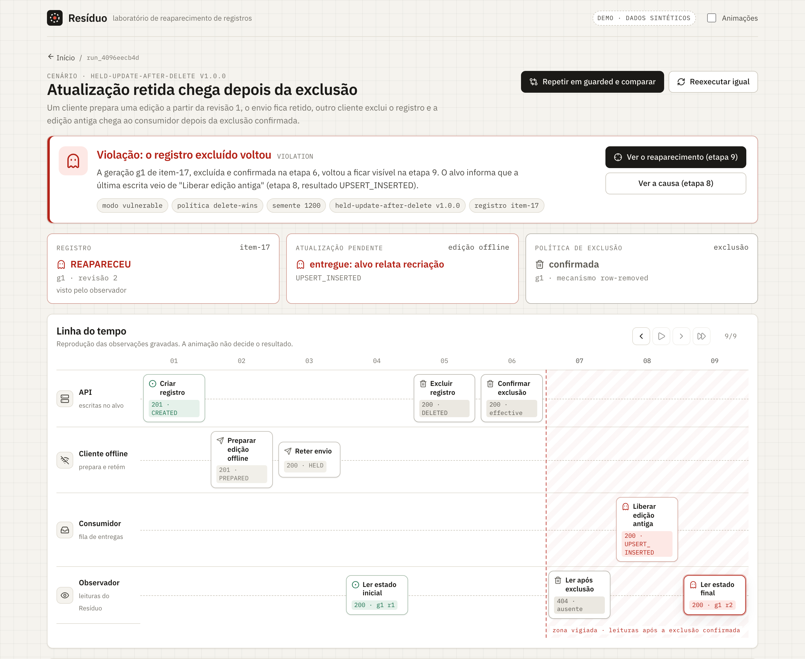
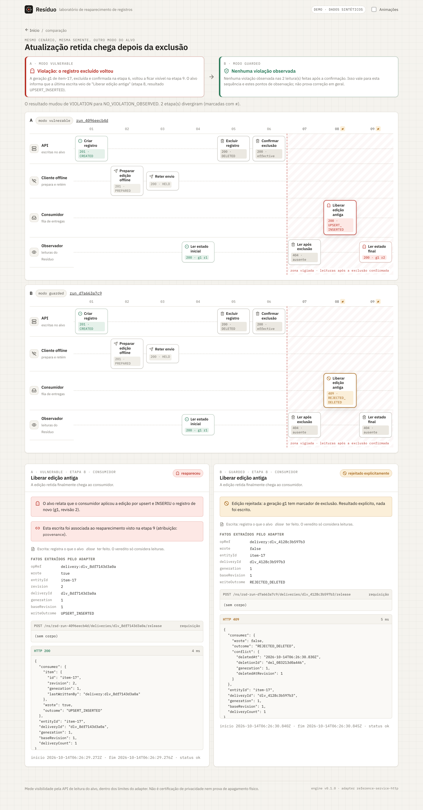

# Resíduo

[](https://github.com/pdrflp0/residuo/actions/workflows/ci.yml)

**Laboratório visual para descobrir como um registro apagado pode reaparecer numa aplicação.**

O Resíduo executa uma sequência controlada contra um serviço de teste real — criar um registro, guardar uma edição antiga, excluir, confirmar a exclusão e só então liberar a edição — e mostra, com evidência, se o registro voltou, em qual operação e se isso viola a política declarada. O resultado é um caso de bug reproduzível, com relatório exportável e um teste de regressão para acompanhar a correção.

> Nível 1 · dados sintéticos de demonstração · alvo: serviço de referência local · ainda não validado com usuários.
>
> **Primeira vez aqui?** Leia [Entenda o Resíduo em 5 minutos](docs/entenda.md): o bug explicado com um exemplo do dia a dia e um glossário.

[](docs/media/residuo-intro.mp4)

▶ [Assistir ao vídeo de apresentação (79 s)](docs/media/residuo-intro.mp4) — feito em código com Remotion a partir de capturas reais do app ([video/](video/)).



---

## O problema, em um exemplo

1. A API cria a ficha `item-17`, **geração g1**, revisão 1.
2. Um cliente prepara uma edição a partir da revisão 1, mas o envio fica retido (fila parada, aparelho offline).
3. Outro cliente exclui o registro; o serviço **confirma** que a exclusão está em vigor.
4. A edição retida chega ao consumidor.
5. No modo `vulnerable`, o consumidor faz *upsert* por id: como a linha não existe mais, o `INSERT` recria `item-17` g1.
6. O Resíduo lê o registro de novo, vê g1 visível e associa o reaparecimento à operação que o alvo informa ter escrito por último.

No modo `guarded`, a mesma sequência termina com a edição **rejeitada explicitamente** (`409 REJECTED_DELETED`) e o registro continua ausente.



Exclusão e edição concorrentes podem ser intenções legítimas em conflito. Por isso a aplicação declara uma **política** (`delete-wins` ou `explicit-restore`), e uma restauração autorizada ou uma nova geração criada explicitamente não são tratadas como bug.

## Rodar localmente

Pré-requisitos: Node.js ≥ 22.12 (desenvolvido com 26.11) e Docker — ou qualquer PostgreSQL local (ver abaixo).

```bash
npm install
npm run db:up        # PostgreSQL 18 em localhost:54329 (docker compose)
npm run dev          # reference-service :4100 · api :4000 · web :5173
```

Abra <http://localhost:5173> e clique em **Rodar a demonstração**.

**Sem interface** (o cenário mínimo direto contra o serviço, com código de saída para scripts):

```bash
npm run lab -- --scenario held-update-after-delete --mode vulnerable   # sai com 1 (VIOLATION)
npm run lab -- --scenario held-update-after-delete --mode guarded      # sai com 0
```

**Tudo em contêineres** (a API também serve a interface compilada):

```bash
docker compose --profile full up --build   # http://localhost:4000
```

**Sem Docker:** use qualquer PostgreSQL ≥ 14 (por exemplo `brew install postgresql@18`) e aponte as variáveis de [.env.example](.env.example) (`TARGET_DATABASE_URL`, `LAB_DATABASE_URL`). Os serviços criam os próprios bancos na primeira execução.

## Testes

```bash
npm test             # engine + integração (precisa do Postgres no ar)
npm run test:e2e     # Playwright: sobe serviços reais em portas e bancos próprios
npm run typecheck
```

| O que o teste demonstra | Onde |
| --- | --- |
| O cenário conhecido produz `VIOLATION` em `vulnerable`, com a liberação apontada como causa | [scenarios.integration.test.ts](apps/reference-service/test/scenarios.integration.test.ts) |
| A mesma sequência não observa violação em `guarded` e a edição recebe rejeição explícita | idem |
| Nova geração legítima (g2) não é classificada como g1 ressuscitada | idem |
| Confirmação indisponível, confirmação pendente e leitura sem resposta geram `INCONCLUSIVE` | idem + [evaluate.test.ts](packages/engine/test/evaluate.test.ts) |
| Resposta de escrita não é prova: só leituras após a confirmação geram violação | [evaluate.test.ts](packages/engine/test/evaluate.test.ts) |
| Reexecução preserva cenário, versão, semente e ordem, e chega à mesma classificação | integração + [api.integration.test.ts](apps/api/test/api.integration.test.ts) |
| Execuções simultâneas com o mesmo id não interferem; reset só apaga o próprio namespace | [scenarios.integration.test.ts](apps/reference-service/test/scenarios.integration.test.ts) |
| Sob corrida real (sem barreiras) entre liberação e exclusão, `guarded` nunca deixa g1 visível e só decide com o lock | [guarded-consumer.integration.test.ts](apps/reference-service/test/guarded-consumer.integration.test.ts) |
| Falha de infraestrutura (namespace sumido, banco do laboratório fora) não vira evidência nem culpa o alvo | [scenarios.integration.test.ts](apps/reference-service/test/scenarios.integration.test.ts) |
| Evidência insuficiente (escrita sem leitura posterior, leitura sem visibilidade, exclusão sem geração) nunca passa | [evaluate.test.ts](packages/engine/test/evaluate.test.ts) |
| A interface só pinta "reapareceu" o que o veredito sustenta | [entity-state.test.ts](apps/web/test/entity-state.test.ts) + [report.test.ts](packages/engine/test/report.test.ts) |
| Ponta a ponta: demo → evidência → causa → exportação idêntica à API → comparação | [e2e/demo.spec.ts](e2e/demo.spec.ts) |
| Navegação por teclado e preferência por movimento reduzido | idem |

Não há mocks do alvo: os testes de integração sobem o serviço de referência (NestJS + PostgreSQL) numa porta livre e o engine fala HTTP com ele. Para conferir que os testes detectam erros, introduzi defeitos de propósito e confirmei que algum teste falhava: sem a checagem de marcador de exclusão (2 testes falharam), com a fronteira "depois da confirmação" deslocada no avaliador (1 falhou) e sem o lock por identidade no consumidor (o teste de corrida falhou em 3 de 3 rodadas).

Uma revisão independente, feita por outro agente de IA, encontrou lacunas reais, todas corrigidas e cobertas por testes. Estão listadas em [docs/revisao.md](docs/revisao.md).

## Como ler o resultado

| Resultado | Significa | Não significa |
| --- | --- | --- |
| `VIOLATION` | A geração excluída voltou a ser visível numa leitura feita depois da confirmação da exclusão, sem restauração permitida. | Que a causa é sempre a etapa apontada: a atribuição diz se veio da procedência informada pelo alvo, da ordem, ou se é desconhecida. |
| `NO_VIOLATION_OBSERVED` | A sequência terminou e as leituras declaradas não viram a geração excluída. | Prova de correção universal. |
| `INCONCLUSIVE` | Timeout, falha de adapter, falta de observação ou exclusão não confirmada. | Aprovação. Nunca é convertido em sucesso. |
| `POLICY_ALLOWED` | Houve reaparecimento permitido, com evidência: nova geração explícita ou restauração autorizada sob `explicit-restore`. | Que qualquer restauração é aceita: sem autorização registrada, é violação. |

## Arquitetura

```
apps/web                React + Vite: bancada, linha do tempo, evidência, comparação
apps/api                NestJS: execuções, persistência (banco lab), relatórios, comparação
apps/reference-service  NestJS: o alvo testado, modos vulnerable/guarded (banco target)
packages/engine         orquestrador, avaliador de invariantes, adapter HTTP, relatórios
packages/contracts      tipos e contrato do adapter compartilhados
```

O avaliador e o alvo ficam em bancos separados: tudo o que o Resíduo sabe do alvo passa pela API HTTP do adapter. Detalhes em [docs/arquitetura.md](docs/arquitetura.md) e decisões em [docs/decisoes.md](docs/decisoes.md).

## Documentos

- [docs/entenda.md](docs/entenda.md) — o problema em linguagem simples e glossário
- [docs/arquitetura.md](docs/arquitetura.md) — componentes, fluxo de uma execução, modelo de dados
- [docs/decisoes.md](docs/decisoes.md) — por que geração ≠ id, como a exclusão é confirmada, o que é observado, por que é reproduzível
- [docs/demo.md](docs/demo.md) — roteiro de demonstração de 60 a 90 segundos
- [docs/exemplo-relatorio.md](docs/exemplo-relatorio.md) e [.json](docs/exemplo-relatorio.json) — relatório real exportado
- [docs/revisao.md](docs/revisao.md) — o que a revisão independente encontrou e como foi corrigido
- [docs/roadmap.md](docs/roadmap.md) — níveis 2 e 3, validação com desenvolvedores, publicação
- [video/](video/) — o vídeo de apresentação como código (Remotion)

## Limites (importante)

- Mede **visibilidade pela API de leitura do alvo**. Ausência numa leitura não é apagamento físico de todas as cópias (réplicas, caches, backups, logs).
- A ordem é controlada por barreiras explícitas: a reexecução reproduz **este interleaving**, não a temporização de uma corrida real. A semente gera só os dados sintéticos; outras ordens de entrega não são exploradas (nível 2).
- O v1 aceita somente o serviço de referência local; não há campo para testar URLs arbitrárias.
- A política "abrir conflito para revisão humana" não está implementada: no modo `guarded`, a edição conflitante é rejeitada com resultado explícito.
- Não é certificação de privacidade, conformidade legal nem exclusão criptograficamente comprovada.
- Ainda não foi usado por desenvolvedores além do autor; utilidade e esforço de integração não estão validados.

## Referências

- [Apache Cassandra — Tombstones](https://cassandra.apache.org/doc/latest/cassandra/managing/operating/compaction/tombstones.html): dados que reaparecem a partir de réplicas antigas.
- [CelinQ — The Resurrection Problem](https://celinq.com/articles/47-resurrection-problem): o conflito exclusão/edição offline e uma solução específica. O problema não foi inventado aqui.
- [Jepsen — Analyses](https://jepsen.io/analyses): testes de correção em sistemas distribuídos; o Resíduo ocupa um recorte bem menor, focado na aplicação e na comunicação visual.

---

## English summary

**Resíduo** ("residue") is a visual lab that reproduces how a deleted record can reappear in an application. It drives a real reference service through a controlled sequence — create, prepare a stale update, hold its delivery, delete, confirm the deletion, release the update — and then reads the record again. A pure evaluator classifies the run as `VIOLATION`, `NO_VIOLATION_OBSERVED`, `INCONCLUSIVE` or `POLICY_ALLOWED` using only recorded observations: write responses are logged but never treated as proof; only reads after a confirmed deletion count.

The reference service has two modes: `vulnerable` (an upsert consumer resurrects the deleted generation) and `guarded` (inbox de-duplication, a per-identity row lock, a tombstone keyed by *(id, generation)*, and base-revision checks; every rejection is explicit). Identity is separated from **generation**, so an explicitly re-created record (g2) is not mistaken for the deleted one (g1) coming back.

Stack: TypeScript, NestJS 12, React 19 + Vite, PostgreSQL 18, Vitest, Playwright. Runs are isolated by namespace; ordering is enforced by explicit barriers (each adapter call returns only after the target finished), not sleeps. Reports export as JSON and Markdown, including a suggested regression test.

Run it: `npm install && npm run db:up && npm run dev`, then open http://localhost:5173. Limits: it measures visibility through the target's read API only, replays one controlled interleaving (not real-time races), and targets only the local reference service in v1.
