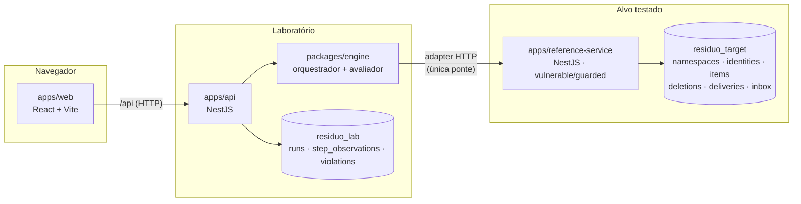
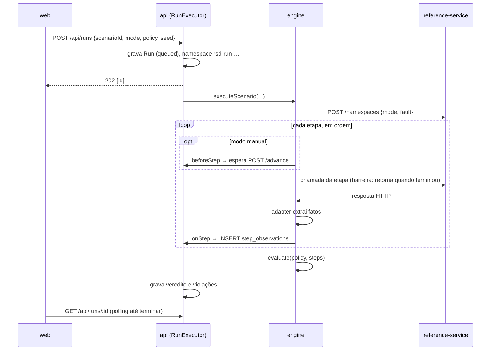
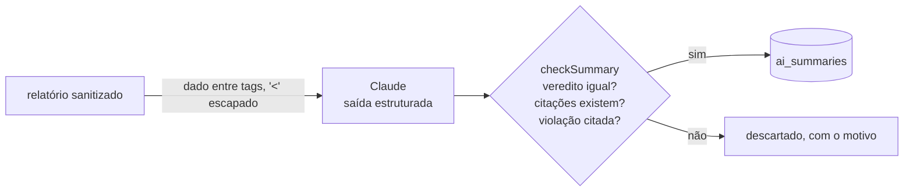

# Arquitetura

## Componentes

- **packages/contracts**: tipos do domínio (`StepObservation`, `Verdict`, `Run`…) e o contrato `TargetAdapter`.
- **packages/engine**: sem framework. `executeScenario` (orquestração), `evaluate` (função pura), `ReferenceHttpAdapter`, relatórios, comparação e narrativa em linguagem simples. Também é usado pelo CLI `npm run lab`.
- **apps/reference-service**: o alvo. Cada requisição lê o modo do namespace no banco, então execuções `vulnerable` e `guarded` podem rodar ao mesmo tempo.
- **apps/api**: cria execuções, roda o engine em segundo plano, grava cada observação assim que ela acontece e serve relatórios e comparações. Em produção local (Docker), também serve a interface compilada.
- **apps/web**: bancada visual; não calcula veredito, só exibe o que a API devolve.

## Fluxo de uma execução

## Contrato do adapter

`TargetAdapter` ([adapter.ts](../packages/contracts/src/adapter.ts)) declara as capacidades conceituais: criar entidade, preparar atualização com revisão-base, reter/liberar/reentregar entrega, excluir, confirmar exclusão, restaurar e inspecionar. `describe()` publica nome, versão, capacidades, pontos de observação e limites, que entram no relatório.

Se o alvo não oferece uma capacidade, o adapter lança `AdapterError('unsupported')`. O engine registra a etapa como `unsupported` e o resultado vira `INCONCLUSIVE`. Há dois adapters: o escrito à mão para o serviço de referência e o genérico, dirigido por `residuo.json` ([integracao.md](integracao.md)). Um teste exige que os dois produzam as mesmas etapas, fatos e vereditos.

## Resumo com IA (opcional)

O avaliador já decidiu antes de a IA entrar. `summarizeReport` ([ai-summary.ts](../packages/engine/src/ai-summary.ts)) usa o SDK oficial com saída estruturada (schema zod), e `checkSummary` confere o resultado por código. A API guarda o resumo numa tabela própria e deduplica pedidos simultâneos para a mesma execução. Sem `ANTHROPIC_API_KEY`, o endpoint responde 503 e a interface explica como ligar.

## Modelo de dados

**Alvo (`residuo_target`)**, tudo chaveado por `ns` com `ON DELETE CASCADE` a partir de `namespaces`:

| Tabela | Papel |
| --- | --- |
| `namespaces` | modo (`vulnerable`/`guarded`) e falha injetada de cada execução |
| `identities` | contador de gerações por id; também é o lock de serialização |
| `items` | estado visível: geração, revisão, dados e `last_written_by` (procedência) |
| `deletions` | registro de exclusões; no `guarded` é o marcador por (id, geração) |
| `deliveries` | fila de entregas do cliente offline: `prepared → held → delivered` |
| `inbox` | deduplicação do consumidor protegido |
| `cache_entries`, `search_index` | dados derivados (nível 3); invalidados na exclusão só no modo guarded |
| `snapshots` | backups (nível 3); o registro de exclusões fica fora deles e é reaplicado após o restore no modo guarded |

**Laboratório (`residuo_lab`)**: `runs` (configuração resolvida, versões, adapter, veredito), `step_observations` (troca HTTP sanitizada + fatos, uma linha por etapa), `violations` (consultáveis por entidade/geração) e `ai_summaries` (resumo opcional da IA, separado do veredito).

## Endpoints

API (`/api`): `GET scenarios`, `POST runs`, `GET runs`, `GET runs/:id`, `POST runs/:id/advance`, `POST runs/:id/replay`, `POST runs/:id/counterpart`, `POST runs/:id/summary[?refresh=1]`, `GET runs/:id/report.json|report.md|report.html|regression.test.ts`, `DELETE runs/:id/target-data`, `GET comparisons?base&candidate`, `GET about`.

Serviço de referência: `POST/GET/DELETE namespaces[/:ns]`, `POST ns/:ns/items`, `GET|DELETE ns/:ns/items/:id`, `POST ns/:ns/items/:id/restore`, `GET ns/:ns/deletions/:id`, `POST ns/:ns/client/updates`, `POST ns/:ns/deliveries/:id/hold|release|redeliver`, `GET ns/:ns/cache/items/:id`, `GET ns/:ns/search/items/:id`, `POST ns/:ns/snapshots`, `POST ns/:ns/snapshots/:id/restore`.

## Segurança do ambiente de teste

- Namespaces precisam casar com `^rsd-[a-z0-9-]{1,80}$`; reset e criação fora disso retornam 400.
- A URL do alvo é configuração do servidor (`REFERENCE_SERVICE_URL`); a API ignora qualquer campo de URL enviado pelo cliente (testado).
- Evidências passam por `sanitize`: valores string em chaves como `authorization`, `token`, `password` ou `apiKey` são mascarados.
- O resumo com IA só sai do computador se alguém clicar em **Gerar resumo** (ou rodar `residuo summarize`) com uma chave configurada, e vai apenas para a URL configurada (`RESIDUO_AI_BASE_URL` ou a padrão da Anthropic).
- As credenciais do Postgres em `docker-compose.yml` e `.env.example` servem só para desenvolvimento local.
